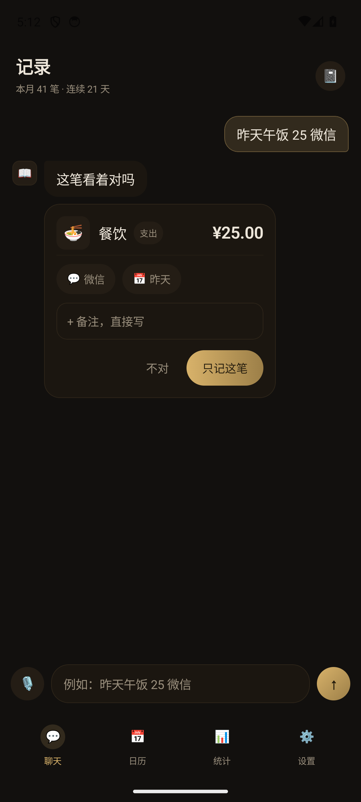
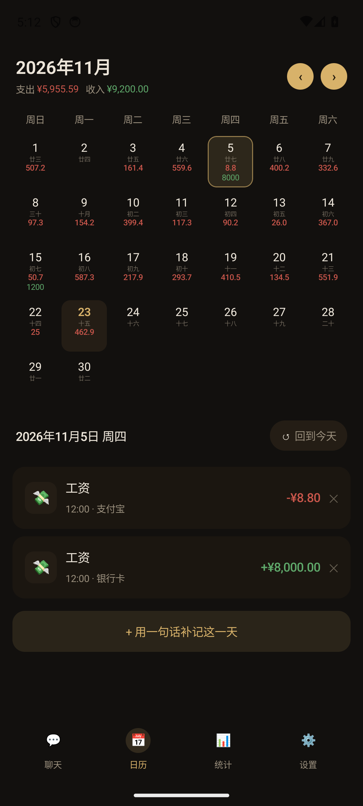
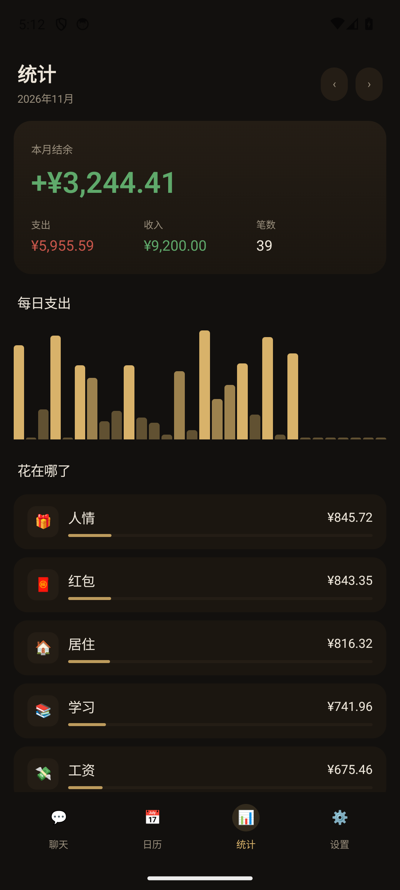

# 记录 · RecordEverything

一个**纯本地、聊天式**的个人记录 App：用人话把一笔账、一次体重、一杯水写进去，自动拆成
金额 / 类别 / 渠道 / 日期，确认一笔就落一笔；日历按天红绿汇总，带农历。

灵感与数据模型来自对 **MarkTimes**（`top.ideaapp.timemark` 1.5.1）的静态逆向分析，逆向报告见
[docs/reverse-engineering.md](docs/reverse-engineering.md)。本项目不是它的复刻：没有账号、没有会员、
没有云同步、没有埋点，所有数据只写在本机一个 JSON 文件里。

<p align="center">
  
  
  
  
</p>

## 它解决什么

记账 App 最大的摩擦不在统计，在**录入**。传统流程是「点 + → 选类别 → 输金额 → 选账户 → 选日期 → 保存」。
这里只有一步：把想说的话打出来（或者说出来）。

```
你：昨天午饭 25 微信
它：这笔看着对吗
    [🍜 餐饮  支出  ¥25.00]
    [💬 微信] [📅 昨天]
    [+ 备注，直接写]
    [不对]  [只记这笔]
```

点「只记这笔」才写入，点「不对」丢弃。草稿里的类别、渠道、日期、备注都能在落账前改。

## 功能

| 模块 | 内容 |
| --- | --- |
| 聊天记账 | 中文口语解析：金额（含 `1.7万` / `1.2k`）、类别（13 类关键词）、渠道（微信/支付宝/现金/银行卡/信用卡/花呗）、日期（今天/昨天/前天/大前天/明天/`10月3日`/`3号`/`周三`）、收入识别、备注自动剥离 |
| 语音输入 | 走系统 `RecognizerIntent`，说完直接进解析流程（不申请录音权限，用系统语音服务） |
| 通用事件 | 「体重 62.5」「喝水 2」「睡眠 7.5」「跑步 5」走独立事件，不进账本 |
| 日历 | 月视图，每格四行：日号 / 农历 / 支出红 / 收入绿；点某天看当天每一笔，可删除，可「用一句话补记这一天」 |
| 统计 | 本月结余、支出、收入、笔数；每日支出柱状图；按类别 / 渠道占比 |
| 数据 | 导出 JSON（完整字段）、导出 CSV（Excel 可读）、清空全部记录、连续记录天数 |
| 外观 | 深色暖金主题，Material 3 |

## 设计取舍

**为什么不用 Room。** 原 App 用 Room + 30 张表 + 22 级迁移，因为要做多设备 WebDAV 同步（tombstone、
修订时钟、租约、commit 日志）。这个项目只服务一台手机，一份 JSON 快照就够，改数据模型不用写迁移。
代价是数据量大时全量重写；实测千级记录仍是毫秒级，够用。

**为什么事件用「属性」而不是「列」。** 逆向看到的核心抽象值得保留：`事件（project）→ 属性（variable）→ 记录值（value）`。
「账本」事件的属性就是类型/金额/类别/渠道，而「体重」只有数值一个属性。加新记录类型不用改表结构，也不用改 UI——
`Seed.kt` 里加一条就有。

**为什么解析放在本地。** 没有网络请求，是为了让「记一笔」永远可用：地铁里、飞行模式、断网都能记。
规则解析的能力上限低于大模型，但延迟是 0、隐私是满的、行为可预测。解析失败会明确说「没看到要记的金额」，
而不是猜一个数字。

**语音为什么不用自己的录音。** 申请 `RECORD_AUDIO` + 自建识别会把 APK 变大、要处理权限被拒的路径、
还要联网。改为调用系统 `RecognizerIntent`，由用户的语音服务（如 Google 语音服务）完成识别，
App 只接收文本，于是仍然只需要 0 个运行时权限。

## 构建

环境：JDK 17、Android SDK（platform 34）、Gradle 8.2.1（wrapper 已带）。

```bash
# 指向你的 SDK
echo "sdk.dir=$HOME/Library/Android/sdk" > local.properties

./gradlew :app:assembleDebug          # 产物：app/build/outputs/apk/debug/app-debug.apk
./gradlew :app:testDebugUnitTest      # 解析器单元测试
adb install -r app/build/outputs/apk/debug/app-debug.apk
```

- `minSdk 24` / `targetSdk 34` / `versionName 1.0.0`
- 依赖只有 Compose（BOM 2024.02.02）、AndroidX core/activity/lifecycle、JUnit
- 无第三方 SDK、无广告、无统计、无网络权限

## 代码结构

```
app/src/main/java/me/nimingzhe/recordeverything/
├── MainActivity.kt          单 Activity + 底部四页
├── data/
│   ├── Model.kt             Event / Attribute / Record / RecordValue
│   ├── Ledger.kt            账本语义（金额、收入判定、格式化）
│   ├── Seed.kt              内置事件：账本、体重、喝水、睡眠、习惯打卡
│   ├── ChatMessage.kt       消息与草稿 Draft
│   └── Store.kt             单文件 JSON 持久化
├── nl/ChatParser.kt         中文口语 → Draft（纯函数，可单测）
├── ui/
│   ├── AppViewModel.kt      状态与全部业务动作
│   ├── ChatScreen.kt        聊天页 + 草稿卡片
│   ├── CalendarScreen.kt    月历 + 当日明细
│   ├── StatsScreen.kt       统计
│   ├── SettingsScreen.kt    导出/清空
│   ├── Theme.kt / Common.kt 配色与小组件
└── util/
    ├── Dates.kt             日期工具（含连续天数）
    └── Lunar.kt             农历（android.icu.util.ChineseCalendar）
```

## 数据文件

`/data/data/me.nimingzhe.recordeverything/files/recordeverything.json`

```jsonc
{
  "events": [ { "id": "...", "name": "账本", "kind": "RECORD",
                "attributes": [ { "id": "...", "name": "金额", "type": "NUMBER", "role": "amount" } ] } ],
  "records": [ { "id": "...", "eventId": "...", "time": 1763952000000, "remark": "午饭",
                 "values": [ { "attributeId": "...", "number": 25.0 } ] } ],
  "messages": [ { "sender": "USER", "text": "昨天午饭 25 微信", "time": 1763952000000 } ]
}
```

写入走「写 `.tmp` → rename」，断电不会留下半个文件。

## 与原 App 的差异

| | MarkTimes 1.5.1 | 记录 RecordEverything |
| --- | --- | --- |
| 授权 | 账号 + 会员（云同步/导出/历史数据是付费点） | 无账号、无内购、无网络 |
| 数据位置 | 本地 SQLite + 可选用户自己的 WebDAV | 本机单 JSON，导出 JSON/CSV |
| 存储 | Room，30 张表，22 级迁移 | 无数据库 |
| 录入 | 表单 + 打卡 + 计时 + 小组件（14 个） | 聊天一句话 + 语音 |
| 视图 | 月/周/时间线/照片/周期 + 17 种格子渲染 | 月历（红绿 + 农历）+ 统计 |
| 统计 | 数据总览/柱状/目标/热图/时长 | 结余/柱状/类别/渠道 |
| 依赖 | Firebase、Bugly、支付宝、微信 SDK | 仅 AndroidX + Compose |
| 体积 | 14.5 MB | debug APK 约 9 MB |
| 提醒/小组件/待办 | 有 | 无（本版未做） |

逆向里最值得抄的三点，已经落进这里：事件+属性+记录值的三层数据模型、中文文案充当唯一的解析词表、
以及「数据在用户手里」这条产品底线。

## 已知限制

- 解析是规则式的：「帮我算一下上周一共花了多少」这类问句不会回答，只认「一句描述一笔记录」。
- 没有编辑已有记录，只能删掉重记。
- 没有提醒、小组件、待办、多账本、多币种。
- 单机单文件，多人/多设备需要自己合并导出。

## 许可

MIT。逆向分析部分仅用于学习与互操作性研究，不含原 App 的任何代码或资源。
