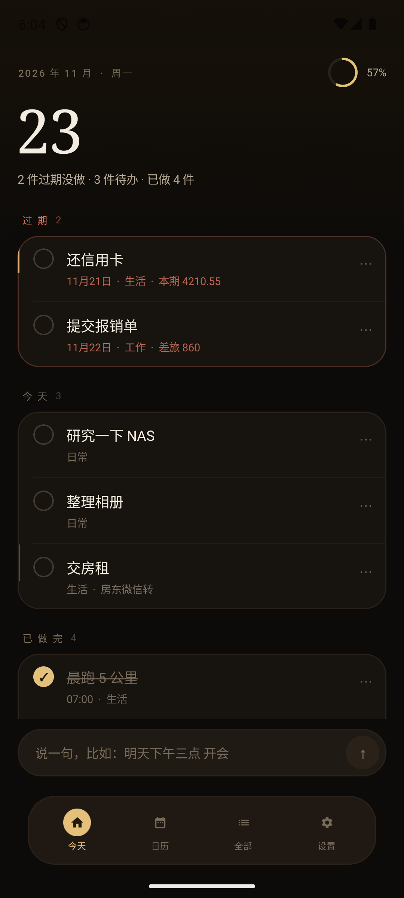
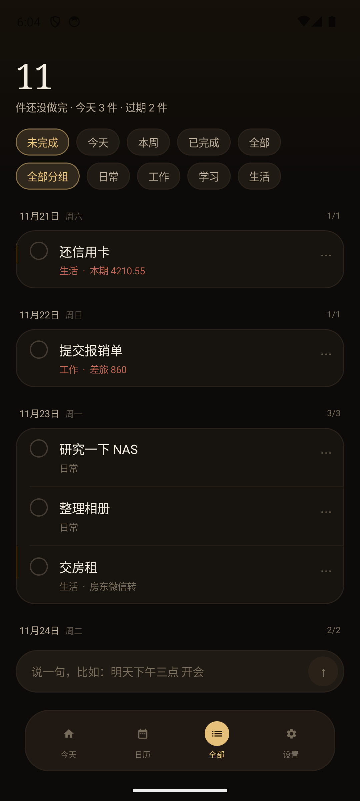
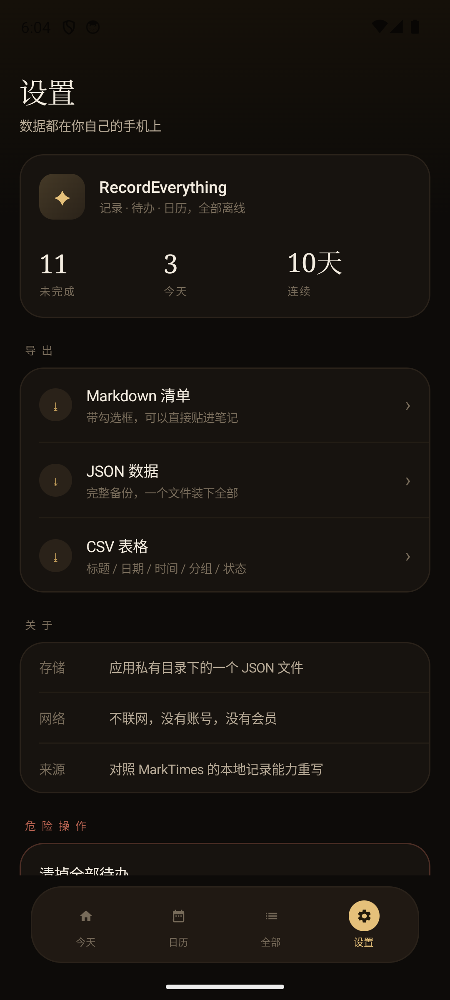

# 记录 · RecordEverything

一个**纯本地、说一句就记下**的待办 / 日程 App：把「明天下午三点开会」这句话丢进去，它自动拆成
标题 / 日期 / 时间 / 分组，确认一下就进清单；过期的事会红着浮到最上面，日历上每天用点标出还剩几件。

灵感与信息结构来自对 **MarkTimes**（`top.ideaapp.timemark` 1.5.1）的静态逆向分析，逆向报告见
[docs/reverse-engineering.md](docs/reverse-engineering.md)。本项目不是它的复刻：没有账号、没有会员、
没有云同步、没有埋点，所有数据只写在本机一个 JSON 文件里。

界面按 [docs/design.md](docs/design.md) 里的一套设计规范实现：纸质手帐的暖 + 工具的静，
炭黑偏暖的底、只在强调处出现的金色、一卡一组的分区、1px 发丝线而不是阴影。

<p align="center">
  
  
  
  
</p>

## 它解决什么

待办 App 最大的摩擦不在整理，在**录入**。传统流程是「点 + → 打标题 → 选日期 → 选时间 → 选分类 → 保存」，
一条事要六下。这里只有一步：把想说的话打出来。

```
你：明天下午三点 开会
它：这样对吗 · 11月24日 15:00
    [开会]
    [明天] [15:00] [工作]  [⚡重要]
    [取消]  [加上]
```

点「加上」才写入，点「取消」丢弃。草稿里的日期、时间、分组、重要标记都能在落库前改。
没写日期的句子也不会丢，直接进「收集箱」——先记下来，回头再排期。

## 功能

| 模块 | 内容 |
| --- | --- |
| 一句话录入 | 中文口语解析：日期（今天/明天/后天/大后天/昨天/`12月3日`/`3号`/`三天后`/`下周一`/`本周三`）、时间（`14:30`/`14点30`/`三点半`/`晚上八点`）、分组（日常/工作/学习/生活，按关键词推断）、「重要」标记；剩下的部分自动变成标题 |
| 今天 | 过期（红）/ 今天 / 已做完 三段；过期项直接置顶并标红日期；每条右侧 `⋯` 可「改 / 今天做 / 推到明天 / 删除」 |
| 日历 | 月视图，带农历；每天用金点标未完成（最多 3 个，多则淡点）、绿点标已完成；点某天看当天全部待办 |
| 全部 | 按「未完成 / 今天 / 本周 / 已完成 / 全部」筛选，按分组收窄，列表按日期分段（含「收集箱」段） |
| 编辑 | 标题、备注、日期、时间、分组、重要标记，走一个对话框改完 |
| 数据 | 导出 Markdown 清单（带 `- [ ]` 勾选框）、导出 JSON 完整备份、导出 CSV；清空需二次确认 |
| 外观 | 深色暖金主题（`#0D0B09` 底 + `#E5C07A` 金），衬线大标题，悬浮胶囊导航，Material 3；规范见 [docs/design.md](docs/design.md) |

## 设计取舍

**为什么不用 Room。** 原 App 用 Room + 30 张表 + 22 级迁移，因为要做多设备 WebDAV 同步（tombstone、
修订时钟、租约、commit 日志）。这个项目只服务一台手机，一份 JSON 快照就够，改数据模型不用写迁移。
代价是数据量大时全量重写；实测千级条目仍是毫秒级，够用。

**为什么解析放在本地。** 没有网络请求，是为了让「记一件事」永远可用：地铁里、飞行模式、断网都能记。
规则解析的能力上限低于大模型，但延迟是 0、隐私是满的、行为可预测。解析不出日期就明确放进收集箱，
而不是猜一个日子。

**为什么先给草稿再落库。** 自然语言解析一定有错，关键是让错误在写进数据之前被看见、被改掉。
草稿卡片上每个字段都能点开换，成本远低于「记错了再回头找那条改」。

**为什么用点而不是数字。** 日历格子只有约 40dp 宽，塞数字会挤掉农历、也会让一屏里出现大量数字噪声。
点的作用是「这天有事」，具体几件点进去看，信息密度和可读性都更好。

## 视觉

2.0 版整体重做了视觉层。三条原则：

1. **一卡一组，而不是一行一卡。** 同一分区的所有行共享一张卡，行间用 1px 发丝线（`#2A221A`）分隔。
   深色界面里阴影几乎看不见，能表达层次的是「底色差 + 线」，不是「卡片投影」。
2. **层级靠字号与字族，不靠颜色堆叠。** 日期用 62sp 衬线体做主角，分区标题是 10sp 加宽字距的
   全大写小字（`过 期`、`今 天`、`做 完`），正文 14.5sp，元信息 11sp 弱色。整个界面只有四档字号。
3. **金色只做强调。** 金色出现在勾选圈、选中日、主按钮、重要条上；大面积填充只用于选中态的
   底部导航胶囊。其余层次全部由三层 surface（`#17130F` / `#201A14` / `#2A2219`）推出来。

动效只有三处，都是 150–220ms：勾选填充、草稿卡进场、完成度圆环。没有弹跳、没有长动画。

实现时踩到的一个真坑：Material 3 的 `Text` 默认继承 `MaterialTheme.typography.bodyLarge`，
包括它的 `lineHeight = 23sp`。只设 `fontSize = 8.sp` 的农历文字仍然占 23sp 行高，把日历格子撑爆、
圆点被裁掉。解法是在主题里用 `CompositionLocalProvider(LocalTextStyle provides TextStyle(color = ...))`
清空默认字号与行高，让每处 `Text` 自己决定。

## 构建

环境：JDK 17、Android SDK（platform 34）、Gradle 8.2.1（wrapper 已带）。

```bash
# 指向你的 SDK
echo "sdk.dir=$HOME/Library/Android/sdk" > local.properties

./gradlew :app:assembleDebug          # 产物：app/build/outputs/apk/debug/app-debug.apk
./gradlew :app:testDebugUnitTest      # 解析器单元测试（10 例）
adb install -r app/build/outputs/apk/debug/app-debug.apk
```

- `minSdk 24` / `targetSdk 34` / `versionName 2.0.0`
- 依赖只有 Compose（BOM 2024.02.02）、AndroidX core/activity/lifecycle、JUnit
- 无第三方 SDK、无广告、无统计、无网络权限（连 `INTERNET` 都没申请）

## 代码结构

```
app/src/main/java/me/nimingzhe/recordeverything/
├── MainActivity.kt          单 Activity + 底部四页 + 编辑对话框
├── data/
│   ├── Todo.kt              待办模型与分组常量
│   ├── Ids.kt               16 位短 id
│   └── Store.kt             单文件 JSON 持久化（写 .tmp 再 rename）
├── nl/TodoParser.kt         中文口语 → 草稿（纯函数，可单测）
├── ui/
│   ├── AppViewModel.kt      状态与全部业务动作
│   ├── TodayScreen.kt       今天：过期 / 今天 / 已做完
│   ├── CalendarScreen.kt    月历 + 当日明细
│   ├── AllScreen.kt         全部：筛选、分组、按日期分段
│   ├── TodoRow.kt           单条待办 + 行内菜单
│   ├── QuickAdd.kt          底部一句话输入 + 草稿卡片
│   ├── EditDialog.kt        编辑对话框
│   ├── SettingsScreen.kt    导出 / 关于 / 清空
│   ├── Theme.kt / Common.kt 配色与小组件
└── util/
    ├── Dates.kt             日期工具（含「今天/明天/后天」chip、连续天数）
    └── Lunar.kt             农历（android.icu.util.ChineseCalendar）
```

## 数据文件

`/data/data/me.nimingzhe.recordeverything/files/recordeverything.json`

```jsonc
{
  "schema": 2,
  "savedAt": 1795426337982,
  "todos": [
    {
      "id": "5acd55bcfe8648be",
      "title": "写周报",
      "note": "汇总本周三条进展",
      "due": 1795363200000,   // 当天 00:00 的毫秒时间戳；null = 收集箱
      "time": 1020,           // 当天第几分钟（17:00 = 17*60）；null = 不设时间
      "done": false,
      "doneAt": null,
      "important": true,
      "group": "工作",
      "createdAt": 1795363200000
    }
  ]
}
```

写入走「写 `.tmp` → rename」，断电不会留下半个文件；读取失败或字段缺失时按空清单处理。

## 与原 App 的差异

| | MarkTimes 1.5.1 | 记录 RecordEverything |
| --- | --- | --- |
| 授权 | 账号 + 会员（云同步/导出/历史数据是付费点） | 无账号、无内购、无网络 |
| 数据位置 | 本地 SQLite + 可选用户自己的 WebDAV | 本机单 JSON，导出 MD/JSON/CSV |
| 存储 | Room，30 张表，22 级迁移 | 无数据库 |
| 定位 | 「记录一切」：事件 + 自定义属性 + 打卡 + 计时 + 待办 + 14 个小组件 | 只做待办 / 日程，一句话录入 |
| 视图 | 月/周/时间线/照片/周期 + 17 种格子渲染 | 月历（点标 + 农历）+ 今天 + 全部 |
| 依赖 | Firebase、Bugly、支付宝、微信 SDK | 仅 AndroidX + Compose |
| 体积 | 14.5 MB | debug APK 约 9 MB |

逆向里最值得抄的是它的**信息结构**：日期是记录的骨、备注是肉、分组是抽屉；日历格子必须在一屏里
同时显示「日期 + 农历 + 状态」。这套东西进了这里，但砍掉了同步、账号、会员、小组件这些让原 App
必须联网和付费的部分。

## 已知限制

- 解析是规则式的：「帮我把上周没做完的挪到本周」这类指令不会执行，只认「一句描述一件事」。
- 没有通知提醒（原 App 的 `PeriodReminderReceiver` 等四类提醒未实现）。
- 没有重复任务、子任务、附件、多设备合并。
- 单机单文件，多人/多设备需要自己合并导出。

## 许可

MIT。逆向分析部分仅用于学习与互操作性研究，不含原 App 的任何代码或资源。
