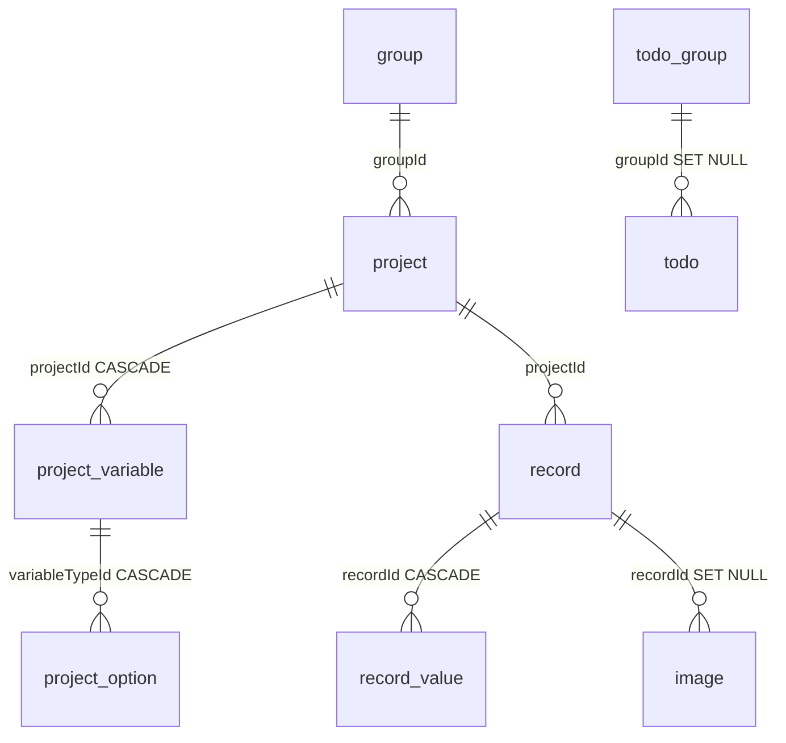

# MarkTimes 逆向分析报告

> 目标：`/Users/user/ding/projects/记录/base.apk` = MarkTimes（`top.ideaapp.timemark`，versionCode 68 / 1.5.1）
> 目的：为 RecordEverything 重建提供设计依据，而非逐行复刻。结论均可回溯到 `work/` 下的静态产物。

## 一、概览

MarkTimes 是**纯本地优先**的个人记录 / 习惯打卡 / 时间追踪 App。核心抽象不是"记账流水"，而是**事件 `project` + 属性
`project_variable` + 记录 `record`/`record_value`**：先定义一件事（喝咖啡、跑步、理发），挂上自定义属性（价格、评分、
心情、时长），之后每次记录就是在这些属性上填一次值。

| 项 | 值 | 证据 |
| --- | --- | --- |
| 包名 / 名称 | `top.ideaapp.timemark` / MarkTimes | `work/apk_smali/AndroidManifest.xml:2`、`work/zh_strings.txt:121` |
| 版本 / SDK | 68 / 1.5.1；minSdk 24、targetSdk 37、compileSdk 37；AGP 9.4.1 | `work/apk_smali/apktool.yml:8-13`、`work/apk/META-INF/.../app-metadata.properties` |
| 体积 | 14.5 MB / 2528 个 zip 条目；dex 11,544,388 + 5,313,464 + 204,248 字节 | `unzip -l base.apk`、`classes*.dex` |
| 原生库 / 入口 | 仅 arm64-v8a 3 个 .so；唯一 launcher `top.ideaapp.timemark.MainActivity` | `work/apk/lib/arm64-v8a/`、`AndroidManifest.xml:41-55` |

栈：Kotlin + Compose（Material3 1.4.0）+ Compose Multiplatform 资源（`composeResources/**.cvr`，值 base64）、Room 2.8.5、
WorkManager 2.12.0、Glance 1.2.0、DataStore 1.3.0、coil3、Ktor、kotlinx.serialization、Bugly、Firebase Analytics、微信
OpenSDK、支付宝 SDK。**没有自建数据后端**：一手域名只有 `mojit.top`（文档 + 深链），其余全是第三方。用户数据只在本地 +
用户自己的 WebDAV。

## 二、分析方法与工具链

**计划路径**：走 REA provider（`jadx-headless-mcp 0.7.1` 提供 `decompile` / `search` / `rename`，单会话内完成"反编译 → 检索 →
交叉引用"）。**该 provider 在本环境不可用**——JAR 无法安装（无网络包源、本地无缓存），MCP 注册无法完成；这是工具链缺口、
不是目标限制，故全部改用 CLI：

| 步骤 | 命令 | 产物 |
| --- | --- | --- |
| 解包 | `unzip base.apk -d work/apk` | 原始 assets / lib / META-INF |
| 资源清单 | `apktool d -f base.apk -o work/apk_smali`（2.11.1，8 线程） | `AndroidManifest.xml`、`res/values/strings.xml` |
| 反编译 | `jadx 1.5.1 --output-dir work/out/sources base.apk` | 10360 类；`top/ideaapp/**` 保留原名，其余进 `p000/` |
| 字符串还原 | 解码 `assets/composeResources/**/strings.commonMain.cvr` 的 base64 | `work/zh_strings.txt`（1423 条，1490 行） |
| DDL / 迁移 | 读 Room 校验类与迁移容器 | `p000/C0431gh.java`（850 行）、`p000/g78.java`（276 行） |

日志：`work/jadx.log` 结尾 `ERROR - finished with errors, count: 116`（10360 类中 116 失败，集中在 Compose 生成的 lambda）；
`work/apktool.log` 无错误。**数据层与导航层完全可读。**

混淆为 R8 单字符映射（类头同一行 `r8-map-id-9d06550...`，`work/out/sources/p000/ipa.java:7`）。业务包 `top.ideaapp.*`
保留原名；`@Metadata` 完整保留，`d2` 里能读回原类名、字段名与模块名。业务类落进 `p000/`（16117 文件），`p015j$` 是 desugar
的 `java.time` 兼容层。**资源与字符串可 100% 还原，逻辑需读反编译代码**（枚举、SQL、协议字段仍可读）。

## 三、架构分层

模块名从 Kotlin metadata 反推（`marktimes-cmp:*` 出现次数）：`base_data` 426、`shared` 75、`feature_analytics` 11、
`feature_webdav` 2、`feature_app_widget` 15；Compose 资源命名空间 `marktimes_cmp.base_data`（372 文件）、`.shared`（37）、
`.feature_todo`（23）、`top.ideaapp.account`（15）、`top.ideaapp.annualreport`（92，其中 88 张插画 webp）。两套名字**不是
一一对应**：`feature_todo` 有资源目录却无模块名，`feature_analytics` / `feature_webdav` 反过来——说明重命名过且未完全
收敛，读代码时不要按名字硬套。

```
top/ideaapp/  timemark/(MTApp·MainActivity·wxapi) · data/(model·repository/local·worker×7·receiver×4·timer)
              appwidget/(10 个 widget 包·12 个配置 Activity·actions) · webdav/ · p000/(混淆的 UI·UseCase)
```

分层单向：`ui(p000)` → `domain(p000 UseCase)` → `data/repository/local` → Room。小组件走另一条路，但**复用 domain**：
`appwidget/actions/PerformFastRecordClickAction.java:44-53` 直接注入 `performFastRecordUseCase` / `projectRepository` /
`updateAllWidgetForProjectUseCase`，所以"桌面一键打卡"与 App 内打卡共用同一套写库逻辑。导航统一用 `sealed interface Route`
（78 个目的地，`work/out/sources/top/ideaapp/data/model/Route.java`），每个目的地自带 `URI_PATTERN`，深链与内部跳转共用同
一份定义，如 `https://mojit.top/timer/{projectId}`、`recordEditRoute/{projectId}?recordId=`、`goalReached?goalDirection=`。

## 四、数据模型

主库 `AppDataBase` 版本 22，identity hash `2bd875e4a42a3533ad3cdddf4c1295d4`，**30 张表**，清单硬编码在
`work/out/sources/top/ideaapp/data/repository/local/AppDataBase_Impl.java:2387`。另有 `WorkDatabase`（v24）与
`AnalyticsDatabase`（v1，hash `d959a71c...`）物理隔离——**统计和调度失败不该污染用户数据**。



三个细节：`record_value` 对 `project_variable` / `project_option` **无外键**（删属性靠应用层清理）；`image → record` 用
`ON DELETE SET NULL` 而非 CASCADE，因为图片文件在磁盘上（`C0431gh.java:525`）；`project_option` 自带 `color`，直接支撑
日历的"选项圆环"。`numericValue` 是 **TEXT** 而非 REAL：属性值可能是 `12.5`、`1h30m`、`+15m`，统一按字符串存、解析
下推到查询层。

```sql
-- work/out/sources/p000/C0431gh.java:507 project（节选）
  `recordType` INTEGER NOT NULL DEFAULT 0,   -- 0=Normal 1=Fast（交互方式）
  `eventType` INTEGER NOT NULL DEFAULT 0,    -- 0=Normal 1=Period（时间形态）
  `remindPeriodicalTime` TEXT NOT NULL DEFAULT '9:00',   -- 定期提醒（周几 + 时间）
  `remindPeriodWeekdays` TEXT NOT NULL DEFAULT '0,1,2,3,4,5,6',
  `calendarRecordType` INTEGER NOT NULL DEFAULT 0, `calendarId` TEXT,   -- 系统日历映射
  `hasOpenGoal` INTEGER NOT NULL DEFAULT 0, `goalType` INTEGER NOT NULL DEFAULT 0,
  `goalPeriod` INTEGER NOT NULL DEFAULT 0, `goalDirection` INTEGER NOT NULL DEFAULT 0,
  `goalCompletionPolicy` INTEGER NOT NULL DEFAULT 0, `goalValue` REAL NOT NULL DEFAULT 1.0,
  `statOrders` TEXT NOT NULL DEFAULT '', `statHiddens` TEXT NOT NULL DEFAULT '',   -- 统计模块序/隐
  `version` INTEGER, `isDeleted` INTEGER NOT NULL DEFAULT 0,
  `lastModTime` INTEGER NOT NULL DEFAULT 0, `localRevision` INTEGER NOT NULL DEFAULT 0,

-- :519 record_value（节选）；:516 record 的索引为 (projectId, isDeleted, recordTime)
  `numericValue` TEXT, `stringValue` TEXT,      -- 数值也存 TEXT，见下
  `variableTypeId` TEXT NOT NULL, `selectOptionId` TEXT NOT NULL,   -- 非选项类型存空串
  FOREIGN KEY(`recordId`) REFERENCES `record`(`id`) ON DELETE CASCADE
```

**30 张表按职责分组**：核心 `project`/`project_variable`/`project_option`/`record`/`record_value`；组织 `group`；媒体 `image`
（`type/url/width/height/size/order/recordId`）与 `missing_image_request`（`imageId/url/expectedSize/localMissingCount`，跨设备缺图
补传）；词典 `icons`/`color`/`time_duration`/`time_adjustment`（`value/type/isPositive/order`）；偏好 `user_preference`
（`enableProjectAliasInCalendarView`）与 `search_history`（`text` 唯一索引）；待办 `todo`（`completeTime/targetDate/targetTime/
reminderTimesInAdvanceInMillis/todoOrder`）/`todo_group`/`todo_app_widget`；同步 `sync_metadata`/`sync_image_queue`/
`sync_tombstone_files`（`filePath` PK）/`webdav_sync_log`/`sync_exported_record_tracking`；协调同步 `sync_coordination_state`/
`sync_pending_commit`/`sync_local_revision_clock`；辅助 `record_draft`（复合主键 `projectId`+`recordId`）/`app_widget`/`receipt_theme`。

**同步列与修订时钟**：15 张表共享 `version` / `isDeleted` / `lastModTime`（跨设备）+ `localRevision`（本机单调）。后者由
**SQLite 触发器维护，业务代码不感知**：

```java
// work/out/sources/p000/vjd.java:14 —— 参与同步的 15 张表
{color, group, image, project, project_option, project_variable, record, record_value,
 search_history, time_duration, time_adjustment, user_preference, todo, todo_group,
 missing_image_request}
// :49-70 每表生成 INSERT/UPDATE 触发器
"UPDATE sync_local_revision_clock SET value = value + 1 WHERE id = 1;
 UPDATE `<t>` SET localRevision = (SELECT value FROM sync_local_revision_clock WHERE id = 1) WHERE ..."
```
其余 15 张（日志、队列、草稿、主题）纯本地，不参与同步——这个划分值得照抄。

**迁移谱系**（`work/out/sources/p000/g78.java`）：9→10（`:109`）预置 `time_duration` 分钟/小时/天三档；10→11（`:123`）全表加
同步三列并新建 6 张 sync 表，**WebDAV 同步在此版上线**；13→14 加 `calendarRecord*`；14→15 加全部 `goal*`；19→20 加
`search_history`/`app_widget`；20→21（`:204`）加 `localRevision` + `sync_local_revision_clock`，是**协调同步的前置改造**
（`lc2.java` case 0 顺带建 `sync_coordination_state` / `sync_pending_commit`）。迁移链**非连续**：`AppDataBase_Impl.java:2364-2382`
里 `4→5`…`8→9` 缺号（历史上合并过），无参 `g78()` 固定 `super(21, 22)`。

## 五、记录引擎

两个**正交**的类型维度最易混淆：

| 列 | 枚举 | 值 | 含义 |
| --- | --- | --- | --- |
| `recordType` | `RecordType`（`p000/yib.java:26-31`） | `Normal=0, Fast=1` | **交互方式**：完整表单 vs 一键打卡 |
| `eventType` | `ProjectType`（`p000/una.java:34-39`） | `Normal=0, Period=1` | **时间形态**：瞬时点 vs 有起止区间 |

`recordType=Fast` 的事件只有一个按钮，点一下写入空 `record`（无 `record_value`）。`fast_log_tips`（`zh_strings.txt:433-435`）：
"它能将繁琐的'点击添加→弹窗填写→确认保存'流程，简化为一步到位的打卡式操作……此外，该功能还支持小组件，无需打开 App，
在手机小组件上就能一键完成记录。"`eventType=Period` 引入 `record.recordStartTime`，`project_event_type_tips`
（`:731`）："时间段类型：专为有明确开始和结束时间的事件设计。除了记录事件本身，还能记录其持续时长，并支持实时计时。"

两个开关组合出四种形态。合并成一个枚举，加第三种时必然爆掉。

**一次写入**："填表式"记录 = `1 条 record + N 条 record_value`（N = 当前可见属性数）。删除是软删除，DAO 在 `UPDATE` 时
同步改 `version` 与 `lastModTime`（`work/out/sources/p000/ly0.java:194-202`）。

**快速计时**是第三类事件入口（`zh_strings.txt:110`），本质是 `eventType=Period` 预设，实现为**前台服务 + 通知**而非后台
计时器：`top.ideaapp.data.timer.RecordTimerForegroundService`（`foregroundServiceType="specialUse"`，子类型
`record_timer_notifications`，`AndroidManifest.xml:215`）；通知支持多事件并行（`当前有%1$d个事件正在计时`，`:922`）；停止
刻意做成"长按 2 秒"（`:550`）防误触。**只存 `recordStartTime`，不存已流逝秒数**，UI 用 `SystemClock.elapsedRealtime()`
重算（`p000/gjg.java:162-183`），进程被杀也不丢时间。

**草稿** `record_draft(projectId, recordId, content, lastUpdated)` 复合主键（`C0431gh.java:551`）：编辑态序列化成 JSON，下次进入
同一 `(project, record)` 时恢复（`record_edit_content_changed`，`zh_strings.txt:890`）。

## 六、视图与统计

五种日历视图：`calendar_month` 月视图 / `calendar_week` 周视图 / `calendar_timeline` 时间轴 / `calendar_photo` 照片日历 /
`calendar_period` 时间段日历（`zh_strings.txt:208-279`）。它们不是五个独立页面，而是**同一组件的五种渲染策略**——数据
源都是"按天聚合的记录集合"，差异只在网格布局与单元格渲染（`CalendarViewSetting` 是全局设置，切视图不重建数据）。

单元格渲染模式 17 种（`CalendarShowType`，`work/out/sources/p000/kn1.java:22-25`）：`None, RemarkPic, OptionLast, OptionsLoop,
NumLast, NumTotal, Text, SwitchYes, SwitchNo, OptionLastText, OptionsAllText, OptionDot, Times, Duration, NumAverage, Sleep,
NumTrendChange`（默认/图片/最后选项圆环/所有选项圆环/最后数值/总数值/文本/是/否/…，`zh_strings.txt:188-205`）。

价值在于**"日历格子显示哪个属性的哪种聚合"是用户配置，不是产品决策**：一个月视图可同时是"体重折线 + 咖啡圆环 + 运动热力"，
因为每格渲染的是 `project.calendarVariableId` 指定的属性。系统日历写法另有 `calendarRecordType`：不同步 / 单次（固定时长）/
单次（从属性取时长）/ 单日聚合 / 时间段（`zh_strings.txt:266-271`）——即"一条内部记录如何映射成一条系统日历事件"。

统计六模块（`zh_strings.txt:1075-1080`）：次数数据分析 / 次数统计图 / 目标 / 次数热图 / 时长统计 / 选项数；趋势页双 tab
次数与时长（`:1363-1364`）。`project.statOrders` / `statHiddens` 两个逗号分隔字符串控制模块**顺序与可见性**（迁移 28→29，
`g78.java:259`），用户可拖拽、可隐藏。`CrossAnalysisBottomSheet` 暗示存在"两事件交叉分析"，但无对应文案，推测实验性
或已下线。

搜索同时命中事件与记录（`home_search_tab_project` / `home_search_tab_record`），历史落 `search_history`。彩蛋：输入
"2025年度报告"打开年度报告页，靠一条内嵌正则（`zh_strings.txt:118`）：`(?<![0-9])([0-9]{4})\s*(?:年度[报報]告|annual\s+
report\b)|\bannual\s+report\s+([0-9]{4})(?![0-9])` —— 兼容简繁"报告"、中英、两种语序，并用前后不接数字的断言避免
误伤 "12025"。

## 七、同步与备份

**边界**：产品把这条写进文案，是整个架构的地基：`vip_description`——"该账号只是用来绑定用户购买会员信息，用户数据都在本地"
（`zh_strings.txt:1394`）。同步 = **用户自己的 WebDAV**，App 只做文件读写、不做中转；`network_security_config` 是空的
`<network-security-config />`（不强求证书固定，因为连的是用户自己的服务器）。远端目录从 dex 字符串常量可直接读出
（`work/apk/classes2.dex`）：`<base>/data/`、`<base>/metadata/delta_index.json`（含版本链）、`<base>/metadata/cleanup_list.json`、
`<base>/full_snapshot_<version>/`、`<base>/images/`；本地备份 zip 内含 `backup_index.json`。

**版本 + 墓碑 + 增量链**：同步日志是**面向用户的自然语言**，协议细节几乎可直接读出（`work/zh_strings.txt:1141-1228`）：
索引缺失→`云端未发现索引文件, 进行全量推送`；链断裂检测 `Error: 增量链断裂, 预期版本为: v%1$s, 实际为: v%2$s`；**双版本号**
`更新云端同步版本号: %1$s, 全量同步版本: %2$s`；跳过策略 `v%1$s(本地)>=v%2$s(远程)，跳过下载阶段`；快照阈值 `增量文件
个数小于指定的 %1$s 个数, 暂时无法进行全量同步`（增量攒够才做快照）。**文件级墓碑**独立建表 `sync_tombstone_files(filePath,
addedTime)`，因为图片/备份文件的删除不能用行级 `isDeleted` 表达。**缺图补传**：`图片下载失败, 已请求源设备补传: %1$s ->
%2$s` + `missing_image_request`——A 传了记录但图没传完，B 写一条缺图请求等 A 上线补传。

**并发控制**两级锁（`zh_strings.txt:1184-1187`）：`🔒 获取同步锁 LockToken: %1$s`（远端用 WebDAV 原生 `LOCK`）、`🔒 本地
写入锁获取, 开始应用所有变更---`（保证 UI 读不到半同步状态）。退避明确：`WebDAV 返回 503，已暂停同步 30 分钟`（`:1434`）；
5 分钟无进展自动中止（`sync_no_progress`）。

**服务端协调同步**（`sync_coordination_title`，`zh_strings.txt:1122`）默认关闭，仅多设备需要，且开启后无法在该目录关闭。
`sync_coordination_tips`：仅使用一台设备时，可以不开启，仍可正常同步。

```sql
-- C0431gh.java:556-558
CREATE TABLE `sync_coordination_state` (
  `resourceBindingId` TEXT NOT NULL,       -- 同步目录 × 账号的服务端绑定标识
  `syncSpaceId` TEXT NOT NULL, `userId` INTEGER NOT NULL,
  `controlPlaneGeneration` TEXT NOT NULL,  -- 服务端代数，防旧端写回
  `bootstrapId` TEXT NOT NULL, `acquireRequestId` TEXT, PRIMARY KEY(`resourceBindingId`));
CREATE TABLE `sync_pending_commit` (`resourceBindingId` TEXT NOT NULL, ..., `commitId` TEXT NOT NULL,
  `payloadJson` TEXT NOT NULL, `payloadHash` TEXT NOT NULL, `capturedRevisionsJson` TEXT, ...);
```

流程是标准 **lease → prepare → commit → mirror**：申请租约（`acquireRequestId`）→ 本地生成 payload 并记下 `payloadHash` +
`capturedRevisionsJson` → 服务端确认提交（`commit_confirmed`）→ 回写云端索引镜像（`mirror_pending`，失败下次修）。异常路径
覆盖完整：租约过期→`同步租约已失效，已保留本地修改，请重新同步`；他设备占用→`其他设备正在同步，请稍后重试`；未登录→
`服务端协调同步需要先登录应用账号`；索引被改→`云端索引出现未知变更，同步已暂停`。`sync_pending_commit` 是**先写本地再提交**：
进程在提交途中被杀，重启能读回 `payloadJson` 重放或撤销。

**备份两套**（别混淆）：`action_portable_backup` 导出数据备份（全库 + 全部图片，zip）、`action_sync_checkpoint_backup` 导出
WebDAV 同步备份（含同步配置与进度，**含 WebDAV 登录信息**）、`action_backup_restore` 还原备份（**破坏性**：还原前删光当前设备
数据与图片）。备份与同步互斥：`正在进行备份恢复中, 暂时不支持同步`；完整性靠 `backup_index.json` 校验，损坏时报
`备份文件中没有找到有效的元数据文件`。

## 八、商业化

VIP 权益（`vip_feature_*`，`zh_strings.txt:1397-1403`）：无限制添加事件数量 / WebDAV网盘同步 / 数据导出 / 历史数据趋势 /
密码管理。档位（`VipType`，`p000/xdf.java:26`）：`Forever=0, Year, Season, Month, SubscriptionByMonth, SubscriptionByYear,
Day`——**Day 排最后**，是后期追加的拉新试用档。

三个要点：**免费版不是阉割版**（记录、日历、统计、小组件全免费，付费墙只立在"往外交互"同步/导出与"往深看"历史趋势/事件
上限上——数据在用户手里的产品，收费点必须是"能力"而非"人质"）；**密码管理也是 VIP 权益**，说明不是系统钥匙串的壳而是
内置凭据库；会员校验放在同步入口而非网络层（`非会员用户无法使用同步功能`，`zh_strings.txt:1227`）。

## 九、权限与组件

权限 23 项 + 1 项自有（`AndroidManifest.xml:3-38`）。网络 `INTERNET`/`ACCESS_NETWORK_STATE`/`ACCESS_WIFI_STATE`（判断
网络类型才触发同步）；图片 `READ_MEDIA_IMAGES`/`READ_EXTERNAL_STORAGE`(≤32)/`WRITE_EXTERNAL_STORAGE`(≤28)/
`ACCESS_MEDIA_LOCATION`（读 EXIF 拍摄地）；提醒 `SCHEDULE_EXACT_ALARM`/`POST_NOTIFICATIONS`/`VIBRATE`/`WAKE_LOCK`/
`RECEIVE_BOOT_COMPLETED`；日历 `READ_CALENDAR`/`WRITE_CALENDAR`；前台服务 `FOREGROUND_SERVICE`/`..._SPECIAL_USE`；
生物识别 `USE_BIOMETRIC`/`USE_FINGERPRINT`；第三方 `BIND_GET_INSTALL_REFERRER_SERVICE`/`AD_ID`/`ACCESS_ADSERVICES_*`。
自有签名级 `top.ideaapp.timemark.DYNAMIC_RECEIVER_NOT_EXPORTED_PERMISSION` 给动态广播加保护（Android 14 后的正确做法）；
`<queries>` 声明要感知小红书、支付宝（大陆+香港）、微信、淘宝。

组件清单 297 行、69 个标签（27 activity + 27 receiver + 10 service + 5 provider）。**15 个桌面小组件**（`exported="true"` +
`APPWIDGET_UPDATE`，`AndroidManifest.xml:63-153`）：周视图 / 周视图图标 / 分组事件 / 待办（中·小）/ 计时（中·小）/ 周打卡
趋势列表 / 事件打卡（小·中）/ 月打卡趋势图 / 周照片墙 / 月度照片墙 / 事件打卡自适应列表（支持时间段）/ 滚动列表，全部在
`top.ideaapp.appwidget.widget.<feature>` 下。配套 12 个 `*ConfigActivity`（`exported="false"`）绑定事件/分组；动作走
Glance：`PerformFastRecordClickAction`（一键打卡）、`PerformCompleteTodoTaskAction`（勾待办）、`WidgetActionBridgeActivity`
（深链桥）。注：任务书写"14 个 widget receiver"，实测 **15 个**（按 `android:name="[^"]*AppWidgetReceiver"` 计数），多出
`weekView.WeekViewIconMAppWidgetReceiver`。

4 个业务 receiver（`exported="false"`）：`PeriodReminderReceiver`、`RecordReminderReceiver`、`RemindAfterDayReceiver`、
`TodoReminderReceiver`。10 个 service 中只有 `RecordTimerForegroundService` 是自家的，其余为 WorkManager ×2、Room
`MultiInstanceInvalidationService`、Glance `GlanceRemoteViewsService`、`RemoteViewsCompatService`、Firebase
`ComponentDiscoveryService`、GA ×2、`android.ext.adservices`。5 个 provider：`FileProvider`
（`top.ideaapp.timemark.provider`）、`FileKitFileProvider`、`AndroidContextProvider`、`InitializationProvider`、Firebase init。

**后台任务** 7 个 Worker（`work/out/sources/top/ideaapp/data/worker/`）：`DeltaSyncWorker`、`FullSnapshotWorker`、
`ImageSyncWorker`、`WebDavCleanupWorker`、`UpdateCleanFileIndexWorker`、`CleanUpZombieRecordsWorker`、`TempFileCleanupWorker`
+ `AnalyticsUploadWorker`。同步拆成增量/全量/图片三个独立 Worker：失败可单独重试，图片（慢任务）不会拖住数据同步。
`CleanUpZombieRecordsWorker` 说明作者踩过"记录指向已删属性"的坑（回到 4.1 的 `record_value` 无外键）。

## 十、与 RecordEverything 的差异

RecordEverything（`me.nimingzhe.recordeverything`）是**重构**，不是复刻。当前脚手架只有 `MainActivity` + 空 Manifest，依赖
仅 compose-bom 2024.02.02 + material3 + activity-compose，尚无 Room / WorkManager / WebDAV。

**保留**（同构）：`project / variable / record_value` 三元组（表达"任意记录场景"的最小完备抽象）；本地优先、无自建后端（数据
主权 + 零运维 + 隐私，也是 MarkTimes 唯一的差异化）；软删除 + `version/isDeleted/lastModTime`（跨设备同步前提，后补代价极大）；
用户自带 WebDAV；导出 CSV/JSON/Text（本地优先的必要出口）；`visibleCondition` 表达式（比"每事件写死字段"灵活一个量级）。

**丢弃**（刻意的减法）：账号/登录/微信扫码/支付宝/VIP 内购（不做商业化，连带登录、购买、二维码、注销全不需要）；服务端
协调同步 lease/commit（需配套后端，单机场景价值不抵复杂度）；Firebase Analytics / Bugly / 广告 ID（隐私优先，且显著抬高
商店审核成本）；PDF 手帐导出 / 小票分享 / 年度报告插画（视觉资产依赖重）；15 种小组件（先做 1–2 种核心）。

**改造**（关键分歧：表单优先 → 对话优先）。MarkTimes 是**表单优先**：点"+" → 弹窗 → 选属性 → 填值 → 保存；`fast_log` 是
对此的妥协（整条流程压成一个按钮），代价是那条记录**没有任何属性值**。RecordEverything 改为**对话优先**：用户打"午饭 35 块
很难吃"，解析器拆成 `{事件: 午饭, 价格: 35, 评分: 1}`，再落成 `record + record_value`。**数据模型完全不变，变的只是入口**
——这让"有属性的快速记录"成为可能，补上了 Fast 与完整表单之间的断层。

**该对话式 UI 在 MarkTimes 中不存在**：`只记这笔` / `结余` / `这笔看着对吗` 三条文案，在 `work/zh_strings.txt`、
`work/strings_decoded.json`、三个 dex、`resources.arsc` 中 grep 均为 0 命中——它是本次重构引入的**设计增量**，实现时不要
去找对应源码。另：`结余` 暗示"余额"，而 MarkTimes 无账户余额模型（只有 `goalValue` 目标值），若坚持该交互需在 `project`
之外新增"账本"聚合，属于**超出原设计范围**的扩展。

## 十一、结论与可复用的设计经验

1. **把"类型"拆成多个正交维度，别挤进一个字段。** `recordType`（交互方式）× `eventType`（时间形态）组合出四种产品形态；
   合并成一个枚举，加第三种时立刻爆炸。
2. **同步列第一天就加上。** 迁移 10→11 才补 `version/isDeleted/lastModTime`，意味着要给 10 张表做 `ALTER TABLE` + 回填
   时间戳；新项目建表时带上，成本为零。
3. **`localRevision` 用触发器维护，而不是业务代码。** `p000/vjd.java` 为 15 张表生成正反向触发器，任何写入路径（小组件、
   后台恢复、手工 SQL）都自动打上本机单调序号——整个同步协议里最省事的一招。
4. **同步拆三个 Worker（增量/全量/图片）+ 一个清理 Worker。** 图片是慢任务，混进数据同步会让一次 503 重试连带拖住记录
   同步。
5. **远端用文件系统布局表达协议，别自造 RPC。** `data/` + `metadata/delta_index.json` + `full_snapshot_<v>/` + `images/`
   全是普通文件，用户用任何 WebDAV 客户端都能看见、能手动备份、能迁移。
6. **破坏性操作要与并发状态互斥。** 备份/还原/同步用互斥标志串起来，避免"边还原边同步"这种难以复现的数据损坏。
7. **把布局决策交给用户配置。** 17 种日历格子渲染 + `statOrders/statHiddens` 排序，让同一日历页服务"减肥看体重曲线"和
   "打卡看次数热图"两类用户；代价是要有好的默认值。
8. **免费版要完整可用，付费墙立在"往外交互"和"往深看"上。** 数据在用户手里的产品，不能把人质当商品。
9. **删除的粒度决定表结构。** 行级软删除用 `isDeleted`，文件级必须另建 `sync_tombstone_files(filePath, addedTime)`；
   `missing_image_request` 解决"图还没传完另一台设备就要看"。
10. **给用户看的中文文案是最可靠的协议文档。** 本次同步协议、并发控制、异常路径几乎全部由 `sync_log_*` /
    `sync_coordination_*` 的 90 余条文案还原，比读混淆后的 Kotlin 流控制快一个量级。

### 附：证据来源

DDL 与迁移：`work/out/sources/p000/C0431gh.java`（project :507，record :516，coordination :556）、`p000/g78.java`、
`p000/mc2.java:24`、`p000/lc2.java`；表清单与迁移注册：`top/ideaapp/data/repository/local/AppDataBase_Impl.java:2387` 与
`:2364-2382`；修订触发器：`p000/vjd.java:14-70`；枚举：`p000/ipa.java:41-56`、`yib.java:26-31`、`una.java:34-39`、
`kn1.java:22-25`、`a85.java:38-46`、`w75.java:29-33`、`j75.java:32-36`、`m75.java:32-36`、`xdf.java:26`、`ild.java:22-26`、
`tld.java:22-26`、`mkd.java:31-41`；中文文案：`work/zh_strings.txt`（1423 条）；清单：`work/apk_smali/AndroidManifest.xml`
（297 行，69 组件）；工具日志：`work/jadx.log`（116/10360 失败）、`work/apktool.log`（无错误）。
